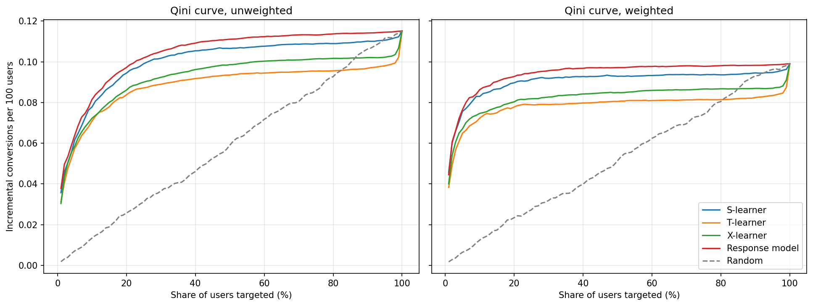
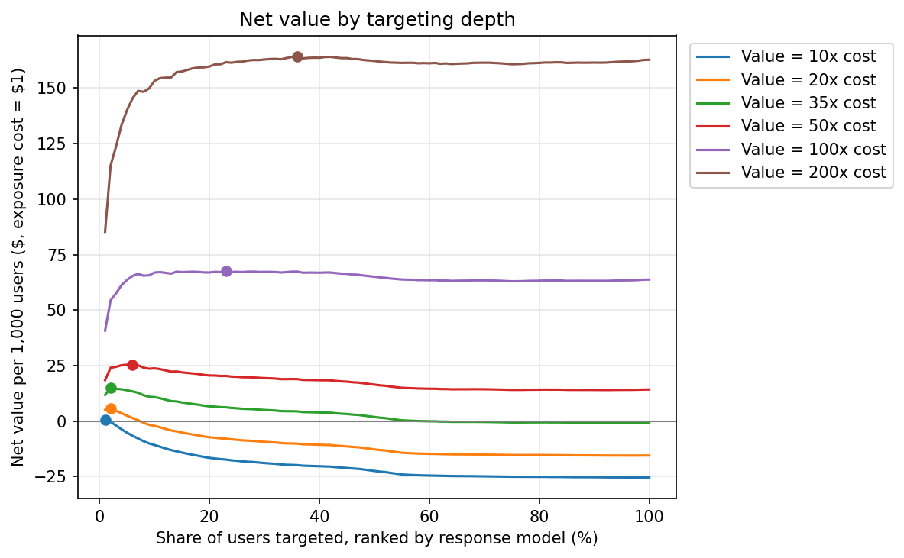

# Criteo Uplift Analysis

Measuring the causal effect of online advertising on 14 million users from a randomized experiment, finding which users the ad actually changes, and deciding how many of them are worth targeting.

The project uses the Criteo Uplift Prediction Dataset, a large randomized advertising experiment in which about 85% of users were eligible to see ads and 15% were held out. It covers a data audit with randomization checks, A/B test analysis with doubly robust estimation, effects on users who actually saw the ad, uplift model comparison with Qini curves and bootstrap intervals, and a targeting decision under different cost assumptions.

## Highlights

- **Data quality:** randomization passed standard balance checks, but a classifier could still tell treatment from control slightly better than chance. This small imbalance, likely from pooling several tests, made a simple difference of means overstate the conversion effect by about 15% and the visit effect by about 38%.
- **Average effect:** after correcting for the imbalance with doubly robust estimation, being assigned to see ads raised the conversion rate by **0.10 percentage points (+48%)**.
- **Effect of seeing the ad:** only about 3.5% of treated users were exposed. For them, the ad roughly **doubled the conversion rate, from 2.5% to 5.4%**. Comparing exposed users directly with the control group overstates this effect by about 80%.
- **Uplift modeling:** a model that ranks users by purchase probability beat the S-, T-, and X-learners (weighted Qini coefficient **0.447** vs. 0.410 for the best uplift learner), and the gap held in all 200 bootstrap draws. The reason is in the data: the ad's effect scales with each user's baseline purchase probability.
- **Targeting:** the top 10% of users deliver **87% of incremental conversions** while using 55% of ad exposures. When a conversion is worth 50 times the cost of an exposure, targeting about the top 6% earns roughly **78% more** than showing ads to everyone.

## Data

[Uplift Modeling, Marketing Campaign Data](https://www.kaggle.com/datasets/arashnic/uplift-modeling) on Kaggle, a copy of Criteo AI Lab's Criteo Uplift Prediction Dataset (v2.1). Each row is one user with 12 anonymized features, a treatment indicator, and three binary labels: visit, conversion, and exposure (whether the user actually saw an ad).

| | Users | Share | Visit rate | Conversion rate | Exposure rate |
|---|---|---|---|---|---|
| Control | 2,096,937 | 15.00% | 3.82% | 0.194% | 0.00% |
| Treatment | 11,882,655 | 85.00% | 4.85% | 0.309% | 3.60% |
| Total | 13,979,592 | 100% | 4.70% | 0.292% | 3.06% |

According to the [original paper](https://s3.us-east-2.amazonaws.com/criteo-uplift-dataset/large-scale-benchmark.pdf), the dataset was assembled from several incrementality tests and sub-sampled non-uniformly for privacy, and the features were randomly projected. Absolute effect sizes therefore describe this dataset rather than Criteo's actual campaigns.

The data is not included in this repository. See [How to reproduce](#how-to-reproduce).

## Project structure

```
notebooks/
  criteo_uplift_analysis.ipynb   Data audit, A/B test analysis, uplift modeling, targeting decision
results/
  README.md                      Notes on the figures
  qini_curves.png
  profit_curves.png
```

## 1. Data audit

- **Complete and consistent.** There are no missing values and all labels are binary. No control user was exposed to an ad, and every conversion has a visit.
- **Duplicates are kept.** About 11.8% of rows are exact duplicates. Because the features are anonymized projections, different users can share identical values, and removing them would distort rates.
- **Randomization holds, with a small but real imbalance.** Every feature's standardized mean difference is below 0.05, well under the usual 0.1 threshold. However, a classifier predicts treatment from the features with ROC-AUC 0.513, while shuffled labels give 0.498 to 0.501. The imbalance is small, but larger than chance. Pooling several tests with different populations is a plausible source.

## 2. A/B test analysis

### Average effect of assignment (intent-to-treat)

| Estimate | Visit | Conversion |
|---|---|---|
| Difference of means | +1.03 pp | +0.115 pp |
| Linear regression adjustment | +0.70 pp | +0.092 pp |
| **Doubly robust (AIPW)** | **+0.75 pp** (95% CI 0.72 to 0.77) | **+0.100 pp** (95% CI 0.093 to 0.107) |
| Relative lift (AIPW) | +18% | +48% |

pp = percentage points.

In a clean randomized experiment, adjusting for features should shrink the standard error but barely move the estimate. Here the linear adjustment lowered the estimates by 20% to 33%. An exact decomposition of the linear adjustment shows why: tiny mean differences in features that strongly predict the outcome add up to a meaningful bias. For visits, two features account for about three quarters of the gap.

The main estimate uses augmented inverse probability weighting (AIPW) with cross-fitted LightGBM models for the propensity score and both outcomes. It remains valid if either the propensity model or the outcome models are correct. Propensity scores range from 0.64 to 0.99, so overlap is good.

### Power

The experiment had far more power than it needed. With an 85/15 split, the minimum detectable effect for conversion (5% significance, 80% power) is 0.009 points, about one eleventh of the estimated effect. A 50/50 split would only lower it from 4.8% to 3.4% relative, and even a 1% holdout would detect an effect of this size.

### Effect on users who actually saw the ad

| Estimate | Conversion effect |
|---|---|
| Naive: exposed users vs. control group | +5.18 pp |
| Complier average causal effect, unadjusted | +3.20 pp |
| **Complier average causal effect, adjusted** | **+2.85 pp** (95% CI 2.65 to 3.05) |

The adjusted estimate divides the AIPW effect by an inverse-probability-weighted exposure rate. Exposed users would have converted at about 2.5% without the ad and converted at 5.4% with it. The naive comparison is misleading because ads tend to be shown to users who are already likely to buy: exposed users would have converted about 13 times more often than the average control user even without the ad.

This estimate assumes that assignment affects outcomes only through exposure and that control users could not be exposed, which the audit confirmed.

## 3. Uplift modeling

Users were split 50/50 into training and test sets, stratified by treatment and conversion. Three meta-learners built on LightGBM were compared with a response model that ranks users by their predicted probability of converting when treated. Models were evaluated with Qini curves on the test set, both unweighted and with propensity weights to correct for the feature imbalance; both versions rank the models the same way.



| Model | Qini coefficient (95% CI) | Captured by top 10% | Captured by top 20% |
|---|---|---|---|
| **Response model** | **0.447** (0.437 to 0.456) | **87%** | **94%** |
| S-learner | 0.410 (0.385 to 0.432) | 84% | 91% |
| X-learner | 0.330 (0.292 to 0.363) | 75% | 81% |
| T-learner | 0.290 (0.249 to 0.325) | 73% | 79% |
| Random | 0.020 | 13% | 24% |

Weighted results. "Captured" is the share of all incremental conversions obtained by targeting only the top-ranked users. Intervals come from a 200-draw Poisson bootstrap; the response model's lead over the S-learner is 0.037 (95% CI 0.016 to 0.058).

### Why the response model wins

Across deciles of the response model's score, the control conversion rate falls about 600-fold, from 1.84% to 0.003%, while the relative lift stays in a similar range of roughly 40% to 120%. The ad multiplies each user's baseline probability, so the users most likely to buy also gain the most in absolute terms. Purchase probability is also much easier to estimate than the difference between two probabilities.

The uplift learners pay a variance cost. The T-learner's control model is trained on only about 1 million users and 2,000 conversions, and its errors produce false negative uplifts: its bottom decile has a predicted uplift of -0.32 points but an observed uplift of +0.17 points. The S-learner shares one model across groups and is the best calibrated of the three.

This result should not be generalized. In campaigns where high-intent users would buy anyway, ranking by purchase probability would waste budget on them, and uplift models would be expected to win. The comparison is worth repeating for each campaign.

## 4. Targeting decision

Ad cost is incurred only when a targeted user is actually exposed, and high-ranking users are exposed far more often: 25.7% in the top 5%, compared with 3.5% overall. The cost of one exposed user is set to $1, so the value of a conversion is expressed as a multiple of that cost.

| Users targeted | Share of exposures | Share of incremental conversions | Incremental conversions per 100 exposures | Break-even value per conversion |
|---|---|---|---|---|
| Top 5% | 37% | 77% | 5.95 | 16.8x |
| Top 10% | 55% | 87% | 4.46 | 22.4x |
| Top 20% | 73% | 94% | 3.60 | 27.8x |
| Everyone | 100% | 100% | 2.81 | 35.6x |



| Value per conversion | Advertise to everyone | Best targeting (response model) |
|---|---|---|
| 10x exposure cost | -25.4 per 1,000 users | Not meaningfully profitable |
| 20x | -15.5 | +5.8 (top 2%) |
| 35x | -0.6 | +14.9 (top 2%) |
| 50x | +14.3 | +25.4 (top 6%) |
| 100x | +63.8 | +67.5 (top 23%) |
| 200x | +162.8 | +164.2 (top 36%) |

- **Targeting matters most when margins are thin.** At 20 to 35 times the exposure cost, advertising to everyone loses money or breaks even, while targeting the top few percent is clearly profitable. At 100 times or more, the net value curve is nearly flat and targeting adds little.
- **The response model gives the highest net value at every margin,** with the S-learner close behind.
- **A range is more reliable than the exact optimum.** The best depths fall in the top few percent, where estimates rest on relatively few conversions, and the curve is flat near its peak. At 50 times the exposure cost, roughly the top 3% to 10% perform similarly.

## Limitations

- The dataset was sub-sampled non-uniformly by its publisher, so absolute effect sizes and net values are specific to this data.
- The features are anonymized and randomly projected, so the models cannot be interpreted in business terms.
- The adjusted estimates assume that the features capture what differs between the pooled tests. If the pooling created imbalance in something the features do not reflect, some bias could remain.
- Cost is modeled per exposed user rather than per impression or bid, and the targeting analysis ignores longer-term effects such as ad fatigue or brand value.
- Uplift models were evaluated on a single train/test split, although the test set is large and bootstrap intervals are reported.

## Tools

Python, SQL (DuckDB), pandas, NumPy, SciPy, scikit-learn, LightGBM, matplotlib, Kaggle Notebooks

## How to reproduce

1. Create a Kaggle notebook with [arashnic/uplift-modeling](https://www.kaggle.com/datasets/arashnic/uplift-modeling) attached, or download the data with the Kaggle API:
   ```
   kaggle datasets download -d arashnic/uplift-modeling
   ```
2. Run `notebooks/criteo_uplift_analysis.ipynb` from top to bottom on a CPU session. On the first run, set `RUN_DATA_PREP`, `RUN_AIPW`, and `RUN_UPLIFT` to `True`. This converts the CSV to Parquet (about 1 minute), fits the cross-fitted AIPW models (about 25 minutes), and fits the uplift models (about 17 minutes), saving each result to `/kaggle/working`.
3. To skip these steps, attach [criteo-uplift-derived](https://www.kaggle.com/datasets/guilinzhao/criteo-uplift-derived), which contains the saved files, and keep all three flags set to `False`. A full run then takes about 12 minutes.

Notebook on Kaggle: [Criteo Uplift Analysis](https://www.kaggle.com/code/guilinzhao/criteo-uplift-analysis)

## Reference

Diemert, E., Betlei, A., Renaudin, C., and Amini, M.-R. "A Large Scale Benchmark for Uplift Modeling." AdKDD Workshop, KDD 2018.
